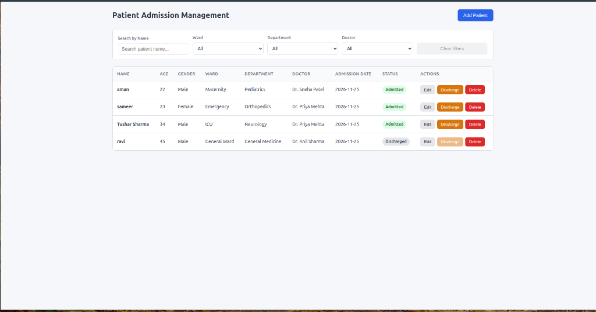

# Patient Admission Management — Frontend

Single-page React (Vite) web application for managing hospital patient admissions, filtering, editing, discharging, and deletion.

## Live Links

- **Frontend:** https://hostpitaladministration.vercel.app
- **Backend API:** https://dscribe-backend.vercel.app

## Tech Stack

- **Frontend:** React, Vite, plain CSS, Fetch API
- **Backend (separate repo):** Python, FastAPI, Pydantic ([Dscribe-backend](https://github.com/saintcoder0/Dscribe-backend))
- **Database:** MongoDB Atlas (`pymongo`)

## Features

- Add new patient admissions via modal form with client-side and server-side validation
- View all patients in a responsive table (desktop/tablet) or stacked cards (mobile `< 640px`)
- Debounced name search (300 ms) combined with Ward, Department, and Doctor filters
- Edit patient details in a modal while preserving admission status
- Mark admitted patients as **Discharged**
- Delete patients with a confirmation dialog
- Dynamic dropdown options fetched from `GET /api/options`

## Project Structure

```text
frontend/
├── screenshots/
│   └── desktop-list.png
├── src/
│   ├── components/
│   │   ├── ConfirmDialog.jsx
│   │   ├── Filters.jsx
│   │   ├── PatientForm.jsx
│   │   └── PatientList.jsx
│   ├── App.jsx
│   ├── api.js
│   ├── index.css
│   ├── main.jsx
│   └── validation.js
├── .env.example
├── .gitignore
├── index.html
├── package.json
└── README.md
```

## Environment Variables

Copy `.env.example` to `.env` and configure:

| Variable | Description | Example |
|----------|-------------|---------|
| `VITE_API_URL` | Base URL of the FastAPI backend | `http://localhost:8000` |

## Steps to Run Locally

1. **Start the backend** (see the [backend README](https://github.com/saintcoder0/Dscribe-backend) for MongoDB Atlas and FastAPI setup).
2. **Install dependencies:**
   ```bash
   npm install
   ```
3. **Configure environment variables:**
   ```bash
   cp .env.example .env
   # Set VITE_API_URL=http://localhost:8000 (or your deployed backend URL)
   ```
4. **Run the development server:**
   ```bash
   npm run dev
   ```
   The app will be available at `http://localhost:5173`.
5. **Production build & lint:**
   ```bash
   npm run lint
   npm run build
   ```

## Screenshot


